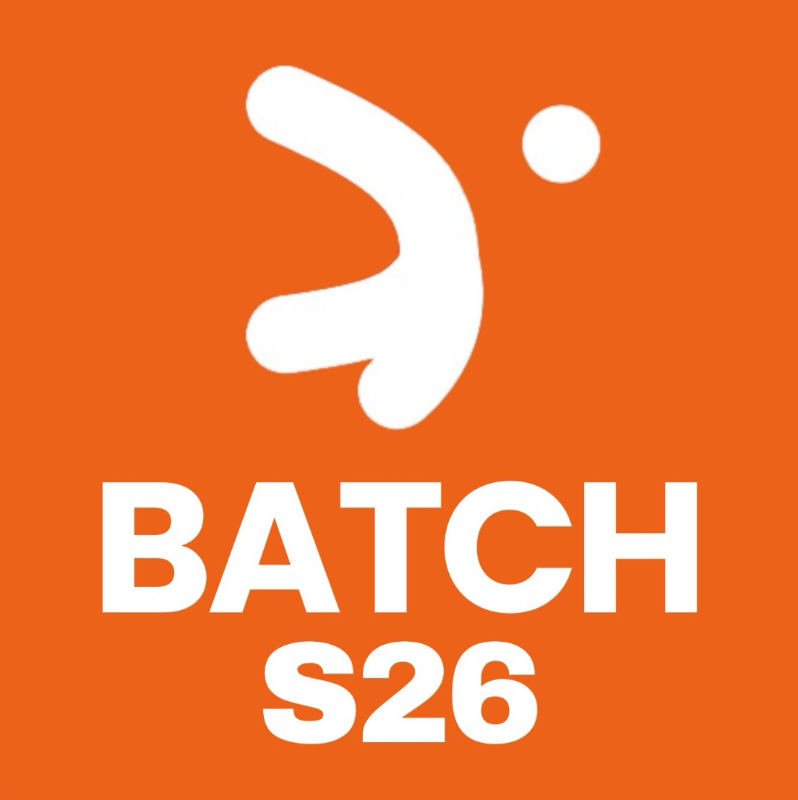
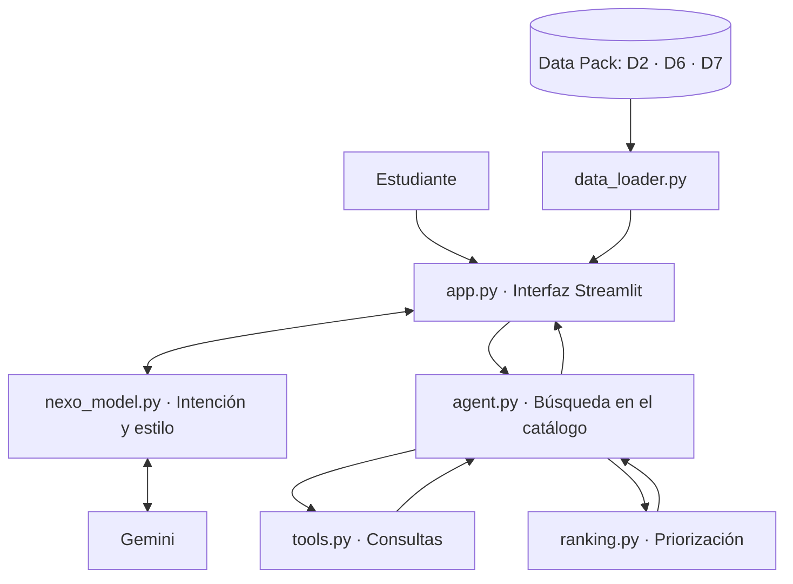

# NEXO

**Encuentra dónde conectar en tu vida universitaria.**

NEXO es un agente web de inteligencia artificial generativa diseñado para facilitar el acceso a actividades, espacios de encuentro y servicios de integración estudiantil en **Ciudad Aethera**.

Desarrollado por **BatchS26 (Chile–Perú)** para la **Misión 4: Aislamiento social**, NEXO transforma solicitudes en lenguaje natural en recomendaciones contextualizadas, considerando la ubicación, institución y disponibilidad de cada estudiante.

**Nuestra propuesta: utilizar inteligencia artificial para facilitar la conexión humana, no para reemplazarla.**

[Descargar NEXO](https://github.com/amandiiita/NEXO/archive/refs/heads/main.zip) · [Guía de instalación](LEEME.md) · [Auditoría](docs/AUDITORIA.md)

## Funcionalidades

- **Conversación contextual:** interpreta necesidades expresadas en lenguaje natural, mantiene el contexto y solicita información relevante.
- Las recomendaciones usan el distrito, la institución y los horarios confirmados. Si un estudiante escribe «trabajo hasta las 18», NEXO le pregunta si puede participar después.
- En **Cómo participar** se muestran horarios, canales y el siguiente paso que se puede guardar durante la sesión. Si faltan una dirección o un teléfono oficial, NEXO indica qué consultar a la institución.
- **Recomendaciones explicables:** presenta ubicaciones, horarios, fechas, características y razones de priorización.
- Los **Detalles técnicos** de la barra lateral muestran qué proveedor respondió, qué herramientas consultó y si se activó el respaldo.
- **Orientación hacia apoyo humano:** facilita información sobre servicios institucionales de orientación y apoyo entre pares.
- **Demostraciones integradas:** permite explorar los recorridos conversacional, de integración y de derivación desde la interfaz.

## Arquitectura

NEXO combina **IA generativa, herramientas de consulta y un motor de priorización basado en reglas explícitas**.

Su arquitectura modular, desarrollada en Python, permite mantener la lógica principal del agente separada de la interfaz web, facilitando su mantenimiento y adaptación a nuevos contextos institucionales.

| Módulo | Función |
| --- | --- |
| `app.py` | Interfaz, conversación, recomendaciones y trazabilidad |
| `nexo_model.py` | Contexto conversacional y validación del plan y la respuesta |
| `agent.py` | Procesamiento del contexto y búsqueda de servicios y actividades |
| `tools.py` | Consulta de actividades, servicios y antecedentes históricos |
| `ranking.py` | Priorización mediante criterios explícitos |
| `data_loader.py` | Lectura y preparación de archivos CSV y GeoJSON |
| `analisis data pack.R` | Análisis cuantitativo que fundamenta el diagnóstico |

### Modelos y herramientas de IA

NEXO puede conversar directamente con el estudiante o consultar el catálogo cuando necesita fundamentar una recomendación. Por defecto intenta usar Groq, luego Ollama con Qwen3 y después Gemini. El equipo puede cambiar ese orden o elegir un funcionamiento exclusivamente local. Si se agotan los modelos disponibles, los recorridos guiados continúan con reglas. [Ver la arquitectura](docs/ARQUITECTURA.md)

### Datos utilizados

NEXO integra tres fuentes del **Data Pack sintético de Ciudad Aethera**:

| Dataset | Aplicación |
| --- | --- |
| `D7_calendar.csv` | Actividades universitarias, fechas, instituciones y períodos de evaluación |
| `D6_services_map.geojson` | Servicios institucionales, distritos, horarios, canales y capacidad |
| `D2_support_services.csv` | Indicadores históricos agregados de espera y asistencia por servicio |

Las recomendaciones se organizan mediante criterios de ubicación, institución, horarios disponibles y calendario académico.

Los datos históricos de D2 complementan la información de los servicios, mientras que los criterios programados en `ranking.py` determinan su priorización.

El diagnóstico inicial fue desarrollado en R utilizando información adicional del Data Pack.

## Cómo probarlo

Sigue la [guía para Mac, Windows y Linux](LEEME.md). Una vez abierta la app, escribe «Quiero conocer gente, pero trabajo hasta las 18». NEXO te preguntará cuándo puedes participar. Después podrás explorar el espacio recomendado, consultar sus horarios y guardar tu próximo paso.

## IA responsable

NEXO incorpora un enfoque de **IA responsable centrada en las personas**, priorizando la autonomía estudiantil, la transparencia de las recomendaciones, la trazabilidad y la equidad en el acceso a oportunidades.

El prototipo trabaja con datos sintéticos y utiliza criterios logísticos explícitos para orientar las recomendaciones. Su propuesta de implementación institucional contempla gobernanza de datos, supervisión humana, actualización de recursos y evaluación continua de seguridad y equidad.

La finalidad es facilitar el acceso a espacios y servicios existentes, promoviendo oportunidades de participación y construcción de redes de apoyo.

## Proyección

La arquitectura modular de NEXO permite proyectar su integración con calendarios, servicios y protocolos de distintas instituciones.

El desarrollo contempla una estrategia de validación mediante pilotos institucionales y una posible expansión hacia universidades de **Chile, Perú y otros países de América Latina**.

---

**BatchS26 | Desafío binacional Chile–Perú | Ciudad Aethera · Misión 4**

*Inteligencia artificial para facilitar la conexión humana, no para reemplazarla.*
