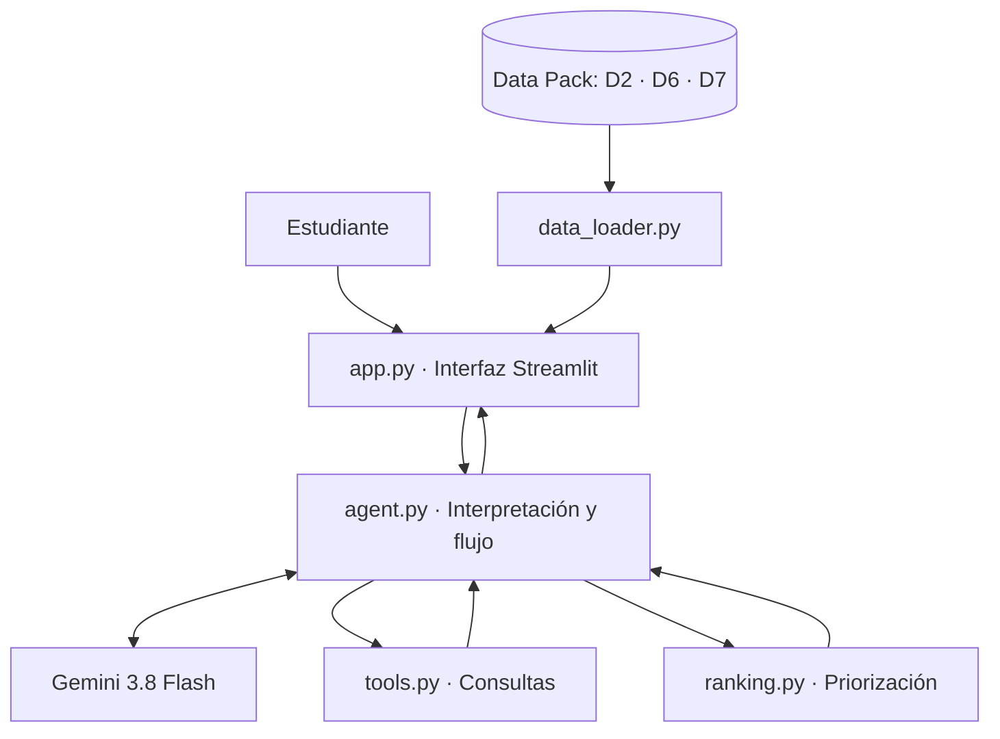

# NEXO

**Encuentra dónde conectar en tu vida universitaria.**

NEXO es un agente web de inteligencia artificial generativa diseñado para facilitar el acceso a actividades, espacios de encuentro y servicios de integración estudiantil en **Ciudad Aethera**.

Desarrollado por **BatchS26 (Chile–Perú)** para la **Misión 4: Aislamiento social**, NEXO transforma solicitudes en lenguaje natural en recomendaciones contextualizadas, considerando la ubicación, institución y disponibilidad de cada estudiante.

**Nuestra propuesta: utilizar inteligencia artificial para facilitar la conexión humana, no para reemplazarla.**

## Funcionalidades

- **Conversación contextual:** interpreta necesidades expresadas en lenguaje natural, mantiene el contexto y solicita información relevante.
- **Recomendaciones personalizadas:** prioriza hasta dos espacios de apoyo entre pares y tres actividades universitarias según criterios de compatibilidad.
- **Recomendaciones explicables:** presenta ubicaciones, horarios, fechas, características y razones de priorización.
- **Trazabilidad del agente:** visualiza el objetivo identificado y las restricciones consideradas durante la interacción.
- **Orientación hacia apoyo humano:** facilita información sobre servicios institucionales de orientación y apoyo entre pares.
- **Demostraciones integradas:** permite explorar los recorridos conversacional, de integración y de derivación desde la interfaz.

## Arquitectura

NEXO combina **IA generativa, herramientas de consulta y un motor de priorización basado en reglas explícitas**.

Su arquitectura modular, desarrollada en Python, permite mantener la lógica principal del agente separada de la interfaz web, facilitando su mantenimiento y adaptación a nuevos contextos institucionales.



| Módulo | Función |
| --- | --- |
| `app.py` | Interfaz, conversación, recomendaciones y trazabilidad |
| `agent.py` | Interpretación de solicitudes y coordinación del agente |
| `tools.py` | Consulta de actividades, servicios y antecedentes históricos |
| `ranking.py` | Priorización mediante criterios explícitos |
| `data_loader.py` | Lectura y preparación de archivos CSV y GeoJSON |
| `analisis data pack.R` | Análisis cuantitativo que fundamenta el diagnóstico |

### Modelos y herramientas de IA

NEXO utiliza **Google Gemini 3.8 Flash** (`gemini-3.8-flash`), integrado mediante **Google GenAI SDK**.

El modelo participa en dos funciones principales:

- **Interpretación:** identifica intenciones y necesidades expresadas en lenguaje natural.
- **Generación de explicaciones:** comunica las recomendaciones de manera contextualizada y comprensible.

El funcionamiento se complementa con herramientas propias desarrolladas en Python, que consultan información institucional y aplican criterios de priorización.

**Tecnologías principales:** Python, Streamlit, Pandas, Google GenAI SDK y Gemini 3.8 Flash.

### Datos utilizados

NEXO integra tres fuentes del **Data Pack sintético de Ciudad Aethera**:

| Dataset | Aplicación |
| --- | --- |
| `D7_calendar.csv` | Actividades universitarias, fechas, instituciones y períodos de evaluación |
| `D6_services_map.geojson` | Servicios institucionales, distritos, horarios, canales y capacidad |
| `D2_support_services.csv` | Indicadores históricos agregados de espera y asistencia por servicio |

Las recomendaciones se organizan mediante criterios de ubicación, institución, horarios disponibles y calendario académico.

Los datos históricos de D2 complementan la información de los servicios, mientras que los criterios programados en `ranking.py` determinan su priorización.

El diagnóstico inicial fue desarrollado en R utilizando información adicional del Data Pack.

## Instalación y ejecución

**Requisitos:**
- Python 3.10 o superior
- Git
- Clave de API de Gemini

### 1. Clonar el repositorio

```bash
git clone https://github.com/amandiiita/NEXO.git
cd NEXO
```

### 2. Crear un entorno virtual

**macOS / Linux**

```bash
python3 -m venv .venv
source .venv/bin/activate
```

**Windows (PowerShell)**

```powershell
python -m venv .venv
.venv\Scripts\Activate.ps1
```

### 3. Instalar las dependencias

```bash
python -m pip install -r requirements.txt
python -m pip install google-genai
```

### 4. Configurar Gemini

Crear el archivo `.streamlit/secrets.toml`:

```toml
GEMINI_API_KEY = "TU_CLAVE_DE_API"
```

La clave debe mantenerse fuera del repositorio público.

### 5. Ejecutar la aplicación

```bash
streamlit run app.py
```

La aplicación estará disponible en:

`http://localhost:8501`

Los archivos `D2_support_services.csv`, `D6_services_map.geojson` y `D7_calendar.csv` deben encontrarse en la carpeta `data/`.

## IA responsable

NEXO incorpora un enfoque de **IA responsable centrada en las personas**, priorizando la autonomía estudiantil, la transparencia de las recomendaciones, la trazabilidad y la equidad en el acceso a oportunidades.

El prototipo trabaja con datos sintéticos y utiliza criterios logísticos explícitos para orientar las recomendaciones. Su propuesta de implementación institucional contempla gobernanza de datos, supervisión humana, actualización de recursos y evaluación continua de seguridad y equidad.

La finalidad es facilitar el acceso a espacios y servicios existentes, promoviendo oportunidades de participación y construcción de redes de apoyo.

## Proyección

La arquitectura modular de NEXO permite proyectar su integración con calendarios, servicios y protocolos de distintas instituciones.

El desarrollo contempla una estrategia de validación mediante pilotos institucionales y una posible expansión hacia universidades de **Chile, Perú y otros países de América Latina**.

---

**BatchS26 | Desafío binacional Chile–Perú | Ciudad Aethera · Misión 4**

*Inteligencia artificial para facilitar la conexión humana, no para reemplazarla.*
