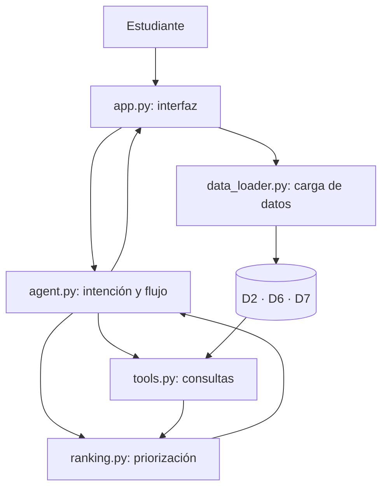

# NEXO

**Encuentra dónde conectar en tu vida universitaria.**

Agente web de IA generativa para facilitar el acceso a actividades y servicios de integración estudiantil en **Ciudad Aethera**. Desarrollado por **BatchS26 (Chile–Perú)** para la Misión 4: Aislamiento social.

NEXO recibe solicitudes en lenguaje natural, reúne información relevante del estudiante y recomienda oportunidades del Data Pack según su distrito, institución y disponibilidad. Su propósito es **facilitar la conexión humana, no reemplazarla**.

## Funcionalidades

- **Conversación contextual:** interpreta solicitudes, conserva el contexto y pregunta por datos faltantes.
- **Recomendaciones explicables:** presenta hasta dos espacios de apoyo entre pares y tres eventos priorizados, con sus características y razones de selección.
- **Trazabilidad:** muestra el objetivo y las restricciones identificadas durante la interacción.
- **Orientación hacia apoyo humano:** ante solicitudes de malestar, presenta servicios de orientación y apoyo entre pares del distrito correspondiente.
- **Demostraciones integradas:** recorridos conversacional, de integración y de derivación desde la interfaz.

## Arquitectura

La lógica principal está organizada en módulos Python independientes de la interfaz Streamlit:



**Gemini** se utiliza para interpretar intenciones y redactar explicaciones; las consultas a los datos y el ordenamiento de las alternativas se ejecutan mediante herramientas y reglas en Python.

| Archivo | Función |
| --- | --- |
| `app.py` | Interfaz, conversación, recomendaciones y panel de trazabilidad |
| `agent.py` | Interpretación de solicitudes y coordinación del flujo |
| `tools.py` | Consulta de eventos y servicios; agregación de historial |
| `ranking.py` | Criterios de priorización de eventos y servicios |
| `data_loader.py` | Lectura y preparación de CSV y GeoJSON |
| `analisis data pack.R` | Análisis exploratorio del problema en R |

### Datos utilizados

| Dataset | Uso en el prototipo |
| --- | --- |
| `D7_calendar.csv` | Actividades, fechas, instituciones y períodos de evaluación |
| `D6_services_map.geojson` | Servicios, distritos, horarios, canales y capacidad |
| `D2_support_services.csv` | Indicadores históricos agregados de espera y asistencia por servicio |

El historial D2 complementa la información, pero no determina la puntuación del ranking. Los archivos D1 y D3 se utilizaron en el diagnóstico estadístico previo, no para clasificar estudiantes durante las recomendaciones.

## Instalación y ejecución

**Requisitos:** Python 3.10 o superior, Git y una clave de API de Gemini para habilitar las funciones generativas.

**1. Clonar el repositorio**

```bash
git clone https://github.com/amandiiita/NEXO.git
cd NEXO
```

**2. Crear y activar un entorno virtual**

macOS / Linux:

```bash
python3 -m venv .venv
source .venv/bin/activate
```

Windows (PowerShell):

```powershell
python -m venv .venv
.venv\Scripts\Activate.ps1
```

**3. Instalar dependencias**

```bash
python -m pip install -r requirements.txt
python -m pip install google-genai
```

**4. Configurar Gemini**

Crear `.streamlit/secrets.toml` en la raíz del repositorio:

```toml
GEMINI_API_KEY = "TU_CLAVE_DE_API"
```

Mantén esta clave fuera del repositorio público. El modelo configurado en `agent.py` debe estar disponible para la clave y el entorno utilizados.

**5. Ejecutar**

```bash
streamlit run app.py
```

La aplicación se abrirá normalmente en `http://localhost:8501`. Los archivos D2, D6 y D7 deben estar dentro de la carpeta `data/`, con los nombres indicados anteriormente.

## Alcance y uso responsable

NEXO es un **producto mínimo viable de demostración** desarrollado sobre datos sintéticos de Ciudad Aethera. Ofrece orientación informativa sobre actividades y servicios institucionales, con criterios visibles y decisión final del estudiante. Las recomendaciones no realizan inscripciones ni reservas automáticas. Para una implementación con estudiantes reales se contemplan controles institucionales de privacidad, actualización de información y derivación humana.

---

**BatchS26 · Desafío binacional Chile–Perú, Ciudad Aethera (Misión 4)**
