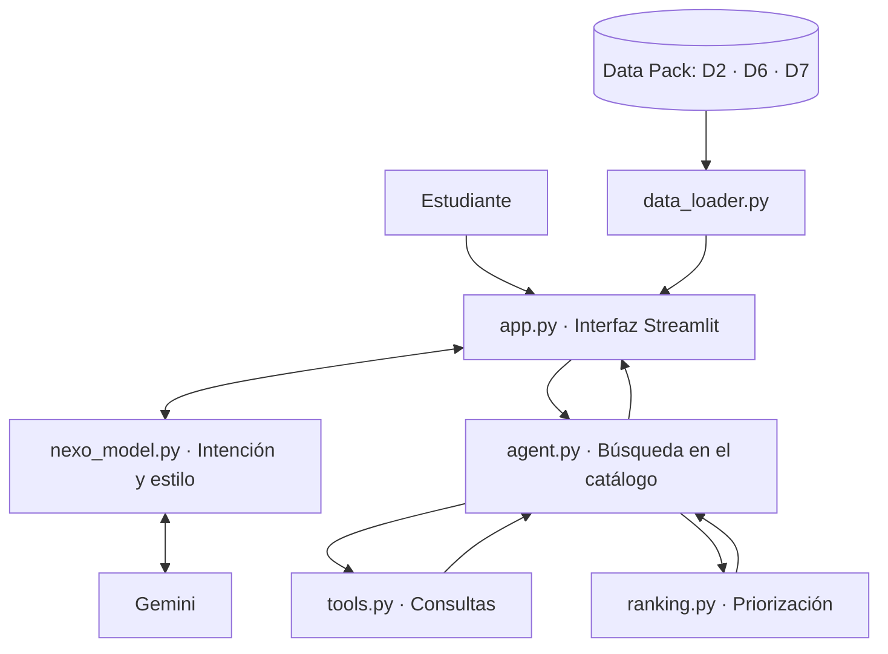

# NEXO

**Encuentra dónde conectar en tu vida universitaria.**

NEXO es un agente web de inteligencia artificial generativa diseñado para facilitar el acceso a actividades, espacios de encuentro y servicios de integración estudiantil en **Ciudad Aethera**.

Desarrollado por **BatchS26 (Chile–Perú)** para la **Misión 4: Aislamiento social**, NEXO transforma solicitudes en lenguaje natural en recomendaciones contextualizadas, considerando la ubicación, institución y disponibilidad de cada estudiante.

**Nuestra propuesta: utilizar inteligencia artificial para facilitar la conexión humana, no para reemplazarla.**

## Funcionalidades

- **Conversación contextual:** interpreta necesidades expresadas en lenguaje natural, mantiene el contexto y solicita información relevante.
- Las recomendaciones usan el distrito, la institución y los horarios confirmados. Si un estudiante escribe «trabajo hasta las 18», NEXO le pregunta si puede participar después.
- En **Cómo participar** se muestran horarios, canales y el siguiente paso que se puede guardar durante la sesión. Si faltan una dirección o un teléfono oficial, NEXO indica qué consultar a la institución.
- **Recomendaciones explicables:** presenta ubicaciones, horarios, fechas, características y razones de priorización.
- Los **Detalles técnicos** de la barra lateral muestran qué intervención tuvo Gemini en el último turno y cuándo respondió el motor local.
- **Orientación hacia apoyo humano:** facilita información sobre servicios institucionales de orientación y apoyo entre pares.
- **Demostraciones integradas:** permite explorar los recorridos conversacional, de integración y de derivación desde la interfaz.

## Arquitectura

NEXO combina **IA generativa, herramientas de consulta y un motor de priorización basado en reglas explícitas**.

Su arquitectura modular, desarrollada en Python, permite mantener la lógica principal del agente separada de la interfaz web, facilitando su mantenimiento y adaptación a nuevos contextos institucionales.



| Módulo | Función |
| --- | --- |
| `app.py` | Interfaz, conversación, recomendaciones y trazabilidad |
| `nexo_model.py` | Solicitud a Gemini, validación de la salida y límite de espera |
| `agent.py` | Procesamiento del contexto y búsqueda de servicios y actividades |
| `tools.py` | Consulta de actividades, servicios y antecedentes históricos |
| `ranking.py` | Priorización mediante criterios explícitos |
| `data_loader.py` | Lectura y preparación de archivos CSV y GeoJSON |
| `analisis data pack.R` | Análisis cuantitativo que fundamenta el diagnóstico |

### Modelos y herramientas de IA

Con una clave configurada, NEXO consulta a Gemini mediante Google GenAI SDK en los turnos habituales de texto, botones y demos. El modelo propone una intención y elige entre estilos de redacción verificados. NEXO comprueba el horario y obtiene del catálogo los nombres, fechas y canales que muestra. Las solicitudes sensibles se atienden por la ruta local de orientación a personas.

Si Gemini supera los 4,5 segundos de espera, devuelve un error o propone una respuesta inválida, el motor local responde en ese mismo turno y conserva la conversación. Después de dos fallos consecutivos, o de inmediato ante errores como cuota o credenciales, NEXO pausa las consultas durante 45 segundos. El siguiente turno después de la pausa puede volver a usar el modelo. Sin una clave, la app funciona directamente con las reglas locales.

### Datos utilizados

NEXO integra tres fuentes del **Data Pack sintético de Ciudad Aethera**:

| Dataset | Aplicación |
| --- | --- |
| `D7_calendar.csv` | Actividades universitarias, fechas, instituciones y períodos de evaluación |
| `D6_services_map.geojson` | Servicios institucionales, distritos, horarios, canales y capacidad |
| `D2_support_services.csv` | Indicadores históricos agregados de espera y asistencia por servicio |

Las recomendaciones se organizan mediante criterios de ubicación, institución, horarios disponibles y calendario académico.

Los datos históricos de D2 complementan la información de los servicios, mientras que los criterios programados en `ranking.py` determinan su priorización.

El diagnóstico inicial fue desarrollado en R utilizando información adicional del Data Pack.

## Instalación y ejecución

Las pruebas se ejecutaron con Python 3.12. Para clonar el proyecto necesitas Git. La clave de Gemini es opcional.

### 1. Clonar el repositorio

```bash
git clone https://github.com/amandiiita/NEXO.git
cd NEXO
```

### 2. Crear un entorno virtual

**macOS / Linux**

```bash
python3 -m venv .venv
source .venv/bin/activate
```

**Windows (PowerShell)**

```powershell
python -m venv .venv
.venv\Scripts\Activate.ps1
```

### 3. Instalar las dependencias

```bash
python -m pip install -r requirements.txt
```

### 4. Configurar Gemini

Para activar la IA, puedes definir la variable de entorno `GEMINI_API_KEY` o crear el archivo local `.streamlit/secrets.toml` dentro del proyecto con este contenido.

```toml
GEMINI_API_KEY = "TU_CLAVE_DE_API"
```

El modelo predeterminado del proyecto es `gemini-3.8-flash`. Si tu cuenta usa otro modelo, indica su identificador en `NEXO_GEMINI_MODEL` como variable de entorno o en el mismo archivo de secretos. Git excluye ese archivo.

### 5. Ejecutar la aplicación

```bash
python -m streamlit run app.py --server.address 127.0.0.1 --server.port 8503
```

Abre `http://127.0.0.1:8503` en tu navegador.

Los archivos `D2_support_services.csv`, `D6_services_map.geojson` y `D7_calendar.csv` deben encontrarse en la carpeta `data/`.

### Comprobar la actualización

Con el entorno activo y desde la raíz del repositorio, ejecuta las dos baterías de pruebas. El primer comando comprueba 52 conversaciones de Streamlit y guarda el detalle en JSON. El segundo comprueba 28 casos del motor. Los casos de Gemini usan respuestas simuladas y se pueden ejecutar sin clave.

```bash
python validar_nexo.py resultados_nexo.json
python test_fallback_sin_streamlit.py
```

Para probarlo en el chat, escribe «Quiero conocer gente, pero trabajo hasta las 18». Confirma la disponibilidad, elige el distrito y la institución, y abre **Cómo participar**. Puedes comprobar cómo se resolvió cada turno en **Detalles técnicos**.

## IA responsable

NEXO incorpora un enfoque de **IA responsable centrada en las personas**, priorizando la autonomía estudiantil, la transparencia de las recomendaciones, la trazabilidad y la equidad en el acceso a oportunidades.

El prototipo trabaja con datos sintéticos y utiliza criterios logísticos explícitos para orientar las recomendaciones. Su propuesta de implementación institucional contempla gobernanza de datos, supervisión humana, actualización de recursos y evaluación continua de seguridad y equidad.

La finalidad es facilitar el acceso a espacios y servicios existentes, promoviendo oportunidades de participación y construcción de redes de apoyo.

## Proyección

La arquitectura modular de NEXO permite proyectar su integración con calendarios, servicios y protocolos de distintas instituciones.

El desarrollo contempla una estrategia de validación mediante pilotos institucionales y una posible expansión hacia universidades de **Chile, Perú y otros países de América Latina**.

---

**BatchS26 | Desafío binacional Chile–Perú | Ciudad Aethera · Misión 4**

*Inteligencia artificial para facilitar la conexión humana, no para reemplazarla.*
